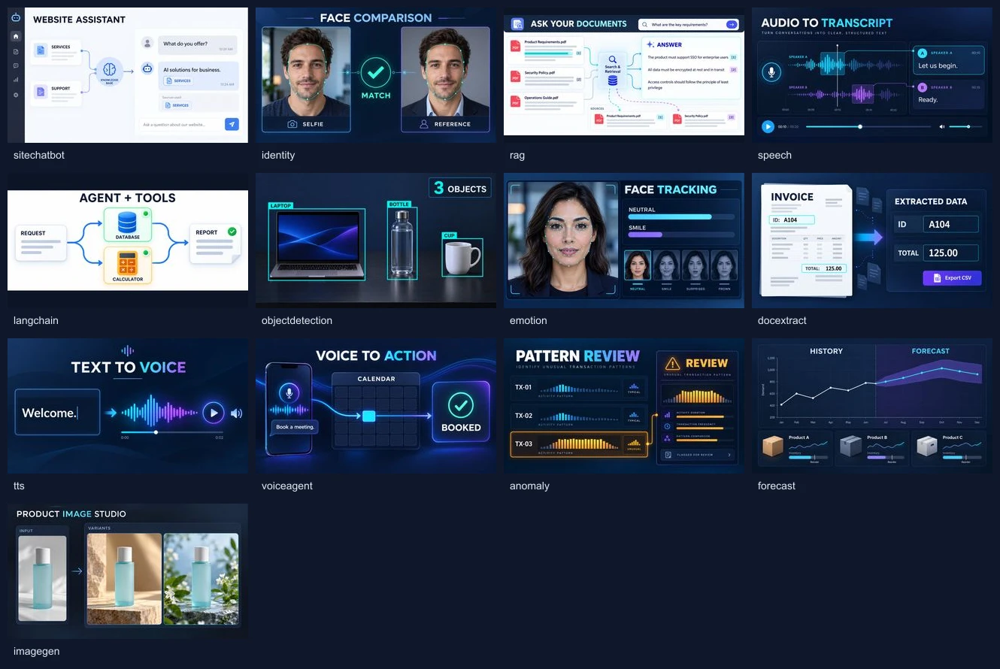

# Firefly concept-video kit — v2

**This replaces the background-only v1 kit.** All 13 first frames are NEW generated conceptual visuals. Each finished video must explain its demo without labels, meshes, boxes or outputs added by the website.



[All video prompts](PROMPTS.md) · [Image-generation prompts and provenance](IMAGE_PROMPTS.md). The overview is for browsing only; upload each individual JPG.

## Firefly settings

Use the current workflow **Veo 3.1 → 720p → Widescreen 16:9 → 24 FPS → 8 seconds → Audio off**. Under **References → Frames → First**, upload that ID's **first-frame-v2.jpg**. Leave Last empty. Paste the complete **firefly-prompt-v2.txt**. Do not mix v1 images/prompts with v2. The files without v2 are legacy materials retained in the repository, excluded from the v2 ZIP.

Each prompt establishes the reference at 0–1s, demonstrates the workflow at 1–6s and holds the completed explanation at 6–8s. Do not truncate to five seconds or crop to 4:3: that would lose the explanation or cut off graphics. These settings match the user's current Firefly screen; model availability may change.

## What changed

- Object detection contains exactly three supported classes (laptop, bottle, cup), three labelled bounding boxes and a count of three.
- Facial-expression and identity scenes include face guides inside the actual image/video. Any moving mesh/box MUST stay attached to the anatomy/object frame by frame.
- RAG, chatbot and tools show sources/request → processing → answer/report, with citations or tool states visible.
- Documents show matching extracted fields; transcription shows speaker-attributed words; TTS shows text becoming a waveform.
- Forecast, voice-agent, anomaly and image-generation scenes include their visual outputs and causal relationship to the input.

All example documents, faces, transactions, chart values and outputs are synthetic concept material, not customer evidence or model-performance measurements. Embedded text is English in this kit. One clip can be reused with localized surrounding page copy; a fully Spanish in-video version would require a separately checked localized master. It must not be simulated by covering moving English graphics with static browser labels.

## Validate the video before accepting it

A prompt cannot guarantee accurate temporal tracking or stable text. The supplied images were visually reviewed, but **the Firefly videos have not been generated or validated yet**. Review the entire eight seconds, including blink/head/object movement, citation/source correspondence, invoice values, correct counts, stable labels and final hold.

Reject a video if landmarks float off the face, boxes lag behind objects, counts disagree, fields change, text morphs, or the scene needs an external overlay to make sense. Regenerate with reduced motion. If the generator cannot maintain tracking, perform real tracking/compositing into the **finished MP4** using an editor/tracker and validate it; do not substitute a static webpage overlay.

## Web export and size

First frames: **1280×720 JPG**, full 16:9, no artificial side overscan. Web delivery: **640×360, full eight seconds, 24 FPS, MP4/H.264/yuv420p, no audio, faststart**. Target <=500 KB, acceptance cap **750 KB**, to be measured on each real clip. More complex moving graphics may need a quality/size iteration; a technically small file can still fail visual review.

```sh
node scripts/encodeFireflyClip.mjs objectdetection /path/objectdetection-firefly-v2-master.mp4 /path/output
```

The updated encoder preserves the full duration and composition, refuses old-format short masters and overwrites, and checks the resulting technical format and size. It never publishes. A technical-format pass does not certify tracking accuracy or text readability.

When integrated into the current 4:3 card media area, use `object-fit: contain` with a matching background, or explicitly redesign the media area after review. Never use cover/crop that discards in-video labels. Do not render the current illustrative CSS face mesh/result panel on top of these self-contained videos. Page caption and playback controls may remain separate.

## Demand loading remains required

These authoring assets live outside public. Real video integration is pending receipt and review of the masters. Initially show a lazy responsive poster with reserved geometry. Do not mount a source or assign a video src at page load or on scroll. Load only the requested clip on desktop hover or mobile touch, muted/playsInline, one at a time. Pause offscreen/hidden; require explicit action for reduced motion/data saver; handle play rejection/error by retaining the poster. Test Network for zero unsolicited MP4 requests, one requested ID, Range 206, correct bytes/duration/dimensions and no layout shift. Website overlays must not supply missing explanatory content.

## Per-demo files

| ID | Complete concept | Status | First frame | Video prompt |
|---|---|---|---|---|
| `sitechatbot` | Show a website-based assistant answering from its source content. | Available | [Image](sitechatbot/first-frame-v2.jpg) | [Prompt](sitechatbot/firefly-prompt-v2.txt) |
| `identity` | Compare a selfie with a reference portrait of the same fictional person. | Available | [Image](identity/first-frame-v2.jpg) | [Prompt](identity/firefly-prompt-v2.txt) |
| `rag` | Retrieve document passages and produce a cited answer. | Available | [Image](rag/first-frame-v2.jpg) | [Prompt](rag/firefly-prompt-v2.txt) |
| `speech` | Turn two speakers audio into an attributed transcript. | Available | [Image](speech/first-frame-v2.jpg) | [Prompt](speech/firefly-prompt-v2.txt) |
| `langchain` | Turn a request into coordinated tool use and a report. | Available | [Image](langchain/first-frame-v2.jpg) | [Prompt](langchain/firefly-prompt-v2.txt) |
| `objectdetection` | Detect, label and count three supported object classes. | Available | [Image](objectdetection/first-frame-v2.jpg) | [Prompt](objectdetection/firefly-prompt-v2.txt) |
| `emotion` | Track facial landmarks and illustrate a change of visible expression. | Available | [Image](emotion/first-frame-v2.jpg) | [Prompt](emotion/firefly-prompt-v2.txt) |
| `docextract` | Extract matching fields from an invoice into structured data. | Available | [Image](docextract/first-frame-v2.jpg) | [Prompt](docextract/firefly-prompt-v2.txt) |
| `tts` | Turn written text into a playable voice waveform. | Available | [Image](tts/first-frame-v2.jpg) | [Prompt](tts/firefly-prompt-v2.txt) |
| `voiceagent` | Convert a spoken appointment request into a calendar action. | Roadmap | [Image](voiceagent/first-frame-v2.jpg) | [Prompt](voiceagent/firefly-prompt-v2.txt) |
| `anomaly` | Identify an unusual transaction pattern and flag it for review. | Roadmap | [Image](anomaly/first-frame-v2.jpg) | [Prompt](anomaly/firefly-prompt-v2.txt) |
| `forecast` | Extend historical observations into a future demand forecast. | Available | [Image](forecast/first-frame-v2.jpg) | [Prompt](forecast/firefly-prompt-v2.txt) |
| `imagegen` | Transform one product input into consistent styled image variants. | Roadmap | [Image](imagegen/first-frame-v2.jpg) | [Prompt](imagegen/firefly-prompt-v2.txt) |

No Adobe video generation, account access, upload or credit spend has occurred in this revision. Image generation used the built-in image_gen tool with the imagegen skill. Full prompts are included above.
