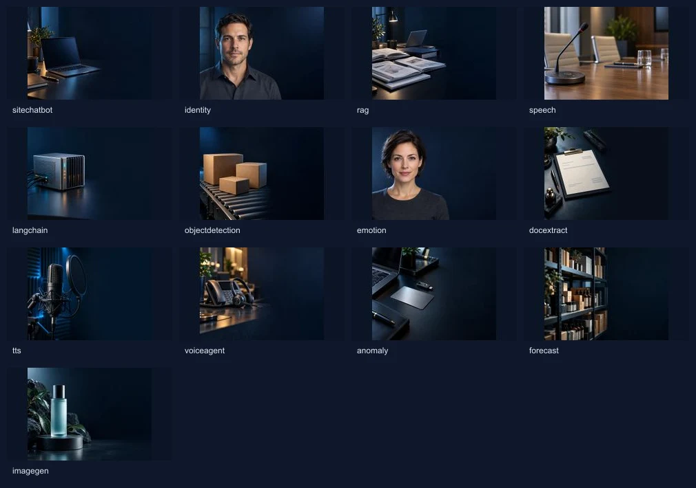

# Kit de clips de Robles.AI para Firefly



La vista general es sólo para elegir el ID; carga en Firefly el JPG individual de cada carpeta.

Incluye una imagen inicial y un prompt independiente por cada una de las 13 tarjetas: diez demos disponibles y tres del roadmap. Se reutilizan las fotos generadas anteriormente con `image_gen`, documentadas en `docs/DEMO_VISUALS.md`. No se han generado nuevos videos ni consumido créditos de Adobe. Los textos de interfaz, resultados y gráficos se añadirán en la web, en EN/ES; no se pide al modelo que los dibuje.

## Cómo generar

1. En Firefly, abre **Video → Generate video → Image to video** y selecciona **Adobe Firefly Video**. Carga la imagen `first-frame.jpg` del ID correspondiente en First frame.
2. Elige **16:9, 720p, cinco segundos, 24 fps**, sin audio. Son los ajustes objetivo; la disponibilidad concreta de controles depende del modelo y de la interfaz. No usar 4K para estas tarjetas.
3. Pega todo el archivo `firefly-prompt.txt` de esa misma carpeta. Cámara fija y movimiento sutil. Opcionalmente usa la misma imagen como último fotograma, si el modelo lo permite; no garantiza un bucle perfecto.
4. Conserva el archivo original descargado con el nombre `<id>-firefly-master.mp4`. No incrustes etiquetas, textos, números, cajas de detección ni gráficos.
5. Revisa el resultado. Para software, el movimiento de fondo sólo acompaña: la explicación de pregunta/respuesta, transcripción, datos y herramientas se compone mediante overlays precisos. Un clip conceptual no sustituye una grabación real del software.

## Tamaño y encuadre

Cada imagen mide **1280×720, 16:9**. Contiene el encuadre original **960×720, 4:3** en el centro, con **160 px de margen lateral** a cada lado. No estirar la imagen ni recortar esos márgenes al cargarla en Firefly. Son overscan para generar en un formato compatible y luego retirar los laterales en la exportación web; no forman parte del diseño final de la tarjeta. Se preserva así la foto completa, su proporción y el espacio destinado a los overlays.

Salida web objetivo: **640×480, 4:3, cinco segundos, 24 fps, MP4/H.264, yuv420p, sin pista de audio, faststart**. Un archivo sirve para EN/ES porque los textos quedan fuera del video. Presupuesto deseado **≤500 KB**, límite de aceptación **750 KB por clip**; es un objetivo que debe medirse tras codificar, no un tamaño garantizado por Firefly. El poster WebP actual permanece como vista inicial.

Después de descargar un original 16:9, desde la raíz del repo:

```sh
node scripts/encodeFireflyClip.mjs rag /ruta/a/rag-firefly-master.mp4 /ruta/de/salida
```

El helper usa FFmpeg/FFprobe ya instalados, valida el formato del original, recorta el área central y escribe sólo en el directorio indicado. No despliega ni activa el clip. No reduce la calidad en silencio para eludir el presupuesto: rechaza un archivo que lo supere para que se revise.

## Entrega a la web: carga realmente a demanda

Los originales y este kit están fuera de `public/`: no se descargan al visitar la web. Los MP4 todavía no están integrados porque falta generarlos y validarlos. Cuando se reciban:

- Mantener imagen responsive con `loading="lazy"` y proporción 4:3 reservada.
- **No crear un `<source>` ni asignar `video.src` al cargar o al hacer scroll.** `preload="none"` solo no garantiza toda la política de demanda.
- Al primer hover de mouse en desktop o toque explícito en móvil, montar/asignar **sólo el clip solicitado**, con `muted`, `playsInline` y `preload="none"`, y solicitar reproducción. Una sola tarjeta reproduce a la vez.
- Pausar al salir, al quedar fuera del viewport y al ocultarse la pestaña. Sin bucle ni descarga anticipada de las otras nueve demos.
- Con movimiento reducido o ahorro de datos, conservar el poster y requerir acción explícita. Manejar rechazo de `play()`, error o falta de clip manteniendo la imagen y el enlace de la demo.
- Añadir a la lista de videos disponibles únicamente IDs con archivo revisado y presente. Mantener animaciones actuales como fallback mientras falten videos. No publicar URLs que den 404.
- Verificar en Network: cero peticiones MP4 al cargar/scroll; una petición sólo para el ID solicitado; respuesta Range 206; MP4 bajo presupuesto, cinco segundos, 640×480 y sin audio; sin cambios de layout ni pérdida de idioma.

Estas reglas son el contrato para la siguiente integración, no una afirmación de que ya se hayan activado clips Firefly en producción. La animación CSS actual sigue su comportamiento existente hasta que se integre el video.

[Ver todos los prompts en un documento](PROMPTS.md).

## Archivos por demo

| ID | Demo | Estado | Fotograma inicial | Prompt |
|---|---|---|---|---|
| `sitechatbot` | Tu chatbot en 60 segundos | Disponible | [Imagen](sitechatbot/first-frame.jpg) | [Prompt](sitechatbot/firefly-prompt.txt) |
| `identity` | Onboarding de clientes en segundos | Disponible | [Imagen](identity/first-frame.jpg) | [Prompt](identity/firefly-prompt.txt) |
| `rag` | Pregúntale a tus documentos | Disponible | [Imagen](rag/first-frame.jpg) | [Prompt](rag/firefly-prompt.txt) |
| `speech` | Actas de reuniones y llamadas automáticas | Disponible | [Imagen](speech/first-frame.jpg) | [Prompt](speech/firefly-prompt.txt) |
| `langchain` | Un asistente que hace tareas, no solo responde | Disponible | [Imagen](langchain/first-frame.jpg) | [Prompt](langchain/firefly-prompt.txt) |
| `objectdetection` | Conteo e inspección con cámara | Disponible | [Imagen](objectdetection/first-frame.jpg) | [Prompt](objectdetection/firefly-prompt.txt) |
| `emotion` | Experiencia del cliente sin encuestas | Disponible | [Imagen](emotion/first-frame.jpg) | [Prompt](emotion/firefly-prompt.txt) |
| `docextract` | Facturas y documentos → datos en segundos | Disponible | [Imagen](docextract/first-frame.jpg) | [Prompt](docextract/firefly-prompt.txt) |
| `tts` | Dale voz a tu contenido | Disponible | [Imagen](tts/first-frame.jpg) | [Prompt](tts/firefly-prompt.txt) |
| `voiceagent` | Recepcionista por voz con IA | Roadmap | [Imagen](voiceagent/first-frame.jpg) | [Prompt](voiceagent/firefly-prompt.txt) |
| `anomaly` | Simulador de fraude en vivo | Roadmap | [Imagen](anomaly/first-frame.jpg) | [Prompt](anomaly/firefly-prompt.txt) |
| `forecast` | Pronóstico de demanda con tus datos | Disponible | [Imagen](forecast/first-frame.jpg) | [Prompt](forecast/firefly-prompt.txt) |
| `imagegen` | Estudio de foto de producto | Roadmap | [Imagen](imagegen/first-frame.jpg) | [Prompt](imagegen/firefly-prompt.txt) |

## Referencias oficiales

- [Generar video a partir de imágenes](https://helpx.adobe.com/firefly/web/work-with-audio-and-video/work-with-video/generate-videos-using-images.html).
- [Formatos y resoluciones de Generate Video](https://developer.adobe.com/firefly-services/docs/firefly-api/getting-started/usage-notes/): incluye 1280×720, 16:9. Las opciones de otros modelos pueden variar.

Los fotogramas son material generado, no imágenes de clientes. Las personas son ficticias. No se han usado credenciales del proyecto ni subido archivos a Adobe.
