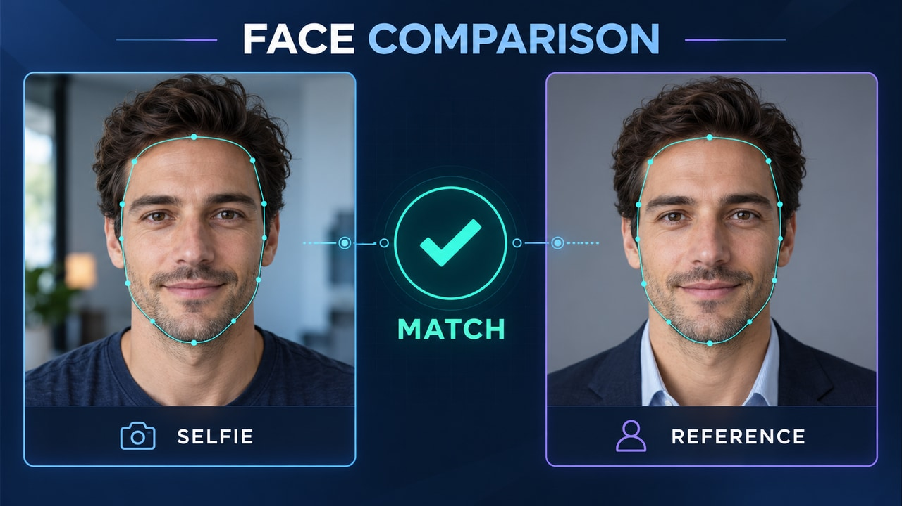

# Customer onboarding in seconds — v2

Concept: Compare a selfie with a reference portrait of the same fictional person.

Use **first-frame-v2.jpg** in Firefly → Frames → First, paste **firefly-prompt-v2.txt**, keep Last empty. Generate 16:9, 720p, eight seconds, 24 fps, Audio off. Preserve the full composition.

Every explanatory label, connector, tracking graphic and output belongs inside the video. The first frame already contains the completed concept; animation demonstrates its relationships.

## Review the actual video

- Both portraits remain the same fictional adult identity.
- Contour follows anatomy without floating or sliding; reference remains still.
- Comparison visibly leads to the MATCH check, without fabricated numerical confidence.
- Reject scrambled text, cropped graphics, detached tracking or a concept that needs a website layer to make sense.

Save the original as **identity-firefly-v2-master.mp4**. Use the v2 encoder to retain all eight seconds in 16:9. Videos have not been generated or temporally validated yet. Files without v2 in this folder are superseded v1 material.
