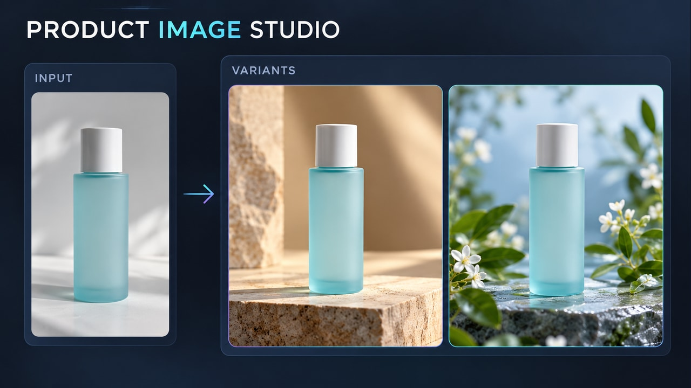

# Product photo studio — v2

Concept: Transform one product input into consistent styled image variants.

Use **first-frame-v2.jpg** in Firefly → Frames → First, paste **firefly-prompt-v2.txt**, keep Last empty. Generate 16:9, 720p, eight seconds, 24 fps, Audio off. Preserve the full composition.

Every explanatory label, connector, tracking graphic and output belongs inside the video. The first frame already contains the completed concept; animation demonstrates its relationships.

## Review the actual video

- The same bottle identity and geometry are preserved in all three panels.
- Output environments are visibly different and originate from the input.
- Both variants are fully visible in the final hold; no browser overlay is required.
- Reject scrambled text, cropped graphics, detached tracking or a concept that needs a website layer to make sense.

Save the original as **imagegen-firefly-v2-master.mp4**. Use the v2 encoder to retain all eight seconds in 16:9. Videos have not been generated or temporally validated yet. Files without v2 in this folder are superseded v1 material.
