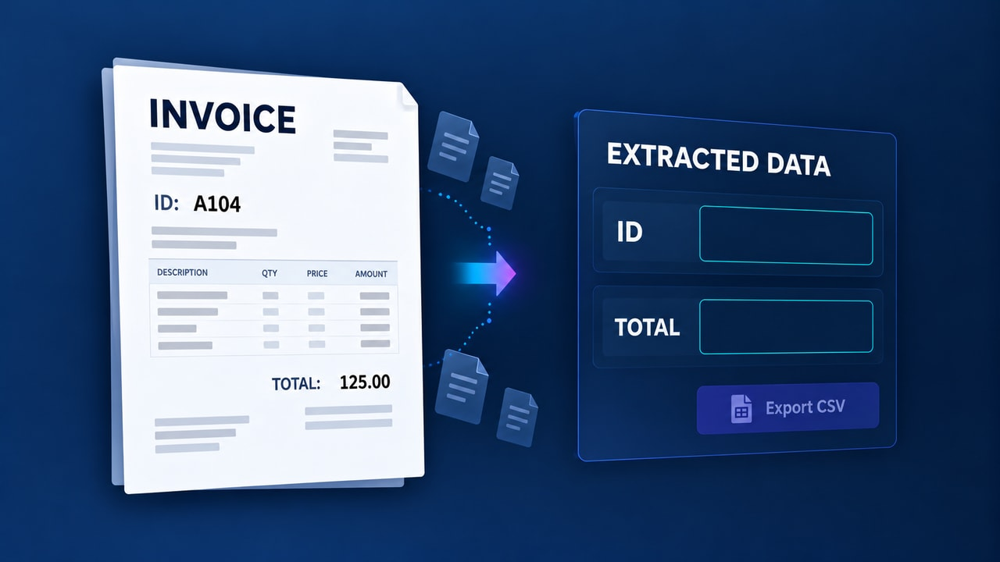
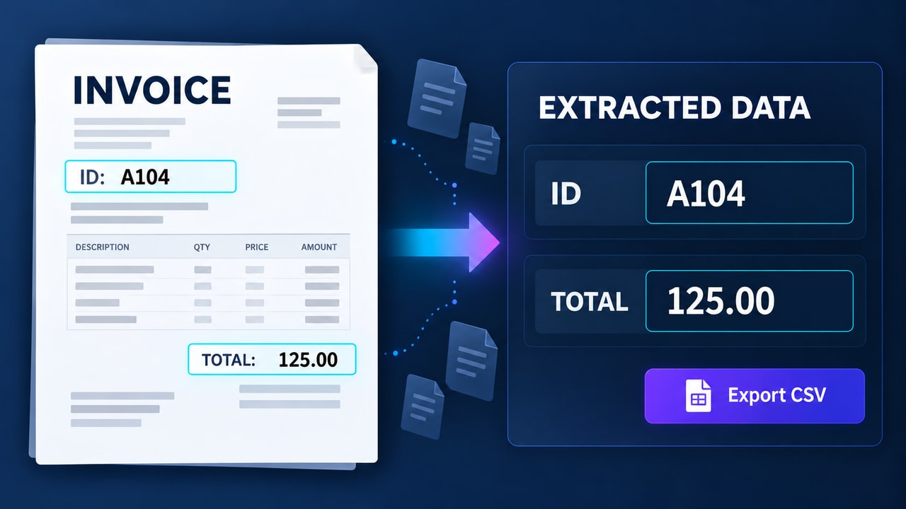

# Facturas y documentos → datos en segundos — pareja v3

**Inicio:** Vista más abierta y oblicua; campos de salida vacíos; cuatro ghosts y flecha en sus posiciones iniciales.

**Final:** Vista cercana y frontal; ID e importe extraídos; ghosts desplazados/inclinados y flecha adelantada.

En Firefly: Frames → First → start.jpg; Last → end.jpg. Usa firefly-prompt.txt completo. 16:9, 720p, 8 segundos, 24 FPS, Audio off.

La transición tiene acciones nuevas y un resultado visible; no debe ser una disolución de toda la imagen ni limitarse a resaltes. Sigue los tiempos y restricciones del prompt. Revisa identidad/geometría, texto, fuentes, valores y sincronización durante todo el video. Los frames orientan los extremos, pero no garantizan una interpolación correcta.

**Estado:** frames preparados; video Firefly pendiente de generación y revisión temporal.

## Registro histórico 3.8 — sustituido por la nueva pareja 3.9 — cámara, flecha y documentos fantasma

First y Last no cambian. Entre ambos se pide un arco suave de cámara 2.5D, desplazamiento aparente limitado, paralaje y regreso al encuadre END antes de los 6 s. La factura y los campos deben permanecer completos y legibles. Los últimos dos segundos quedan quietos.

Solo los cuatro documentos fantasma existentes tienen deriva corta y ligera inclinación; regresan a sus posiciones finales, sin multiplicarse ni cubrir campos. La flecha recibe dos impulsos breves, ligados a las extracciones de ID y TOTAL, con barrido de luz dentro de su silueta y sin estelas nuevas. La extracción conserva exactamente A104 y 125.00.

El prompt queda bajo 2.500 caracteres. No se generó ni se validó temporalmente un video nuevo; rechazar movimiento que deforme texto, despegue highlights o introduzca documentos/flechas extra.

## Revisión vigente 3.9 — ambos frames rehechos

Usar los nuevos start.jpg Y end.jpg, además del nuevo prompt. No combinar esta pareja con los frames 3.8. START se derivó del nuevo END para mantener la misma factura, datos, panel y cuatro documentos fantasma. Se revisaron visualmente ambos extremos.

- START: composición más abierta y oblicua; factura/panel menores; campos vacíos; ghosts más cercanos a la factura con poses iniciales; flecha menor, retraída y tenue.
- END: composición más cercana y frontal; campos A104 y 125.00 completos; cuatro ghosts desplazados hacia la salida y con escalas/ángulos distintos; flecha mayor, adelantada y activa.

La cámara avanza en un solo recorrido hacia END, sin volver a START. Cada ghost sigue un recorrido corto entre sus propios extremos, sin duplicarse ni tapar campos. La flecha avanza y se reorienta entre sus poses reales. Todo se estabiliza antes de 6 s; se lee el resultado hasta 8 s.

Estas son referencias raster generadas, no geometría 3D calibrada ni capturas reales de un motor OCR. La continuidad/interpolación temporal debe revisarse en el video generado; el prompt no garantiza trayectorias exactas. No se generaron videos nuevos en esta entrega.
