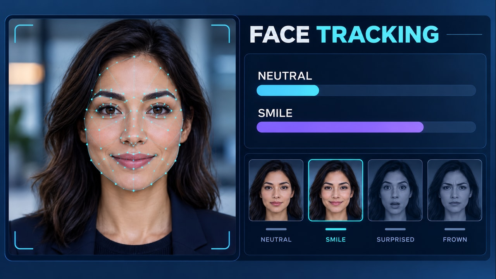

# Experiencia del cliente sin encuestas — pareja v3

**Inicio:** Rostro neutro ya analizado, puntos/malla visibles, NEUTRAL alto, SMILE bajo y miniatura NEUTRAL seleccionada.

**Final:** Sonrisa con seguimiento y resultado.

En Firefly: Frames → First → start.jpg; Last → end.jpg. Usa firefly-prompt.txt completo. 16:9, 720p, 8 segundos, 24 FPS, Audio off.

La transición tiene acciones nuevas y un resultado visible; no debe ser una disolución de toda la imagen ni limitarse a resaltes. Sigue los tiempos y restricciones del prompt. Revisa identidad/geometría, texto, fuentes, valores y sincronización durante todo el video. Los frames orientan los extremos, pero no garantizan una interpolación correcta.

**Estado:** frames preparados; video Firefly pendiente de generación y revisión temporal.

## Registro 3.6 — seguimiento desde el primer frame

Se reutiliza el visual neutro existente con landmarks internos y barras pobladas; no se hizo una generación nueva. END mantiene la sonrisa. Los puntos ya están presentes al inicio y se deforman con labios/mejillas durante la sonrisa, mientras NEUTRAL baja y SMILE sube. La transición no adquiere una malla al final ni comienza con barras vacías. Los puntos permanecen sobre el rostro; solo la selección cambia a la miniatura SMILE.

No son métricas reales del modelo ni inferencias de estado mental. El nuevo video todavía debe generarse y revisarse durante todo el movimiento.

## Revisión vigente 3.7 — expresión y barras con evolución conjunta

Los frames no cambian. Se corrige la transición para evitar una sonrisa más intensa a mitad del clip que al final, mientras la barra sigue aumentando. La expresión y ambas barras avanzan juntas: mitad del cambio a los 2,5 s, estado final a los 4,5 s y pausa conjunta hasta 8 s. La sonrisa nunca supera la intensidad del frame END ni se relaja después. Si el rostro se pausa, las barras también.

Las cuatro fotografías de miniaturas permanecen estáticas; solo cambia una vez su selección. No se debe convertir la miniatura NEUTRAL en una segunda cara sonriente.

Evidencia de la incidencia: tres capturas aportadas por el usuario, no una revisión del MP4 completo. El prompt exige sincronía, pero no garantiza la interpolación del generador. Si persiste, la vía de precisión es animar rostro y gráficos con composición/seguimiento dentro del MP4 y un mismo controlador temporal, no seguir aceptando indicadores desconectados ni añadir overlays web. La nueva generación sigue pendiente de revisión.
