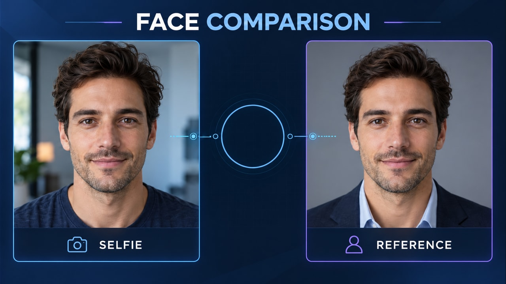
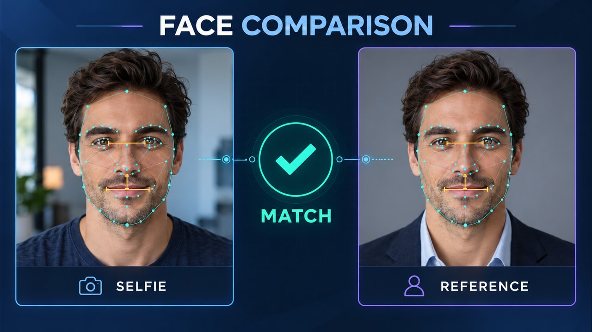

# Onboarding de clientes en segundos — pareja v3

**Inicio:** Retratos sin comparar.

**Final:** Landmarks internos en ojos, cejas, nariz, labios y mejillas, con malla ligera y tres guías geométricas por rostro; comparación completada.

En Firefly: Frames → First → start.jpg; Last → end.jpg. Usa firefly-prompt.txt completo. 16:9, 720p, 8 segundos, 24 FPS, Audio off.

La transición tiene acciones nuevas y un resultado visible; no debe ser una disolución de toda la imagen ni limitarse a resaltes. Sigue los tiempos y restricciones del prompt. Revisa identidad/geometría, texto, fuentes, valores y sincronización durante todo el video. Los frames orientan los extremos, pero no garantizan una interpolación correcta.

**Estado:** frames preparados; video Firefly pendiente de generación y revisión temporal.

## Revisión 3.1 — landmarks internos

El final sustituye el contorno aislado por puntos internos, conexiones trianguladas y guías entre anclajes de ojos, nariz/labio y boca. El inicio no cambia. El prompt adquiere primero los landmarks, añade guías y después presenta MATCH.

Las guías ámbar no son mediciones reales ni valores en milímetros. La UI de la demo describe su puntaje como similitud coseno entre embeddings faciales; esta ilustración no afirma que el resultado se calcule solo con distancias geométricas. No se inventan puntajes. El video corregido todavía debe generarse y validarse.
