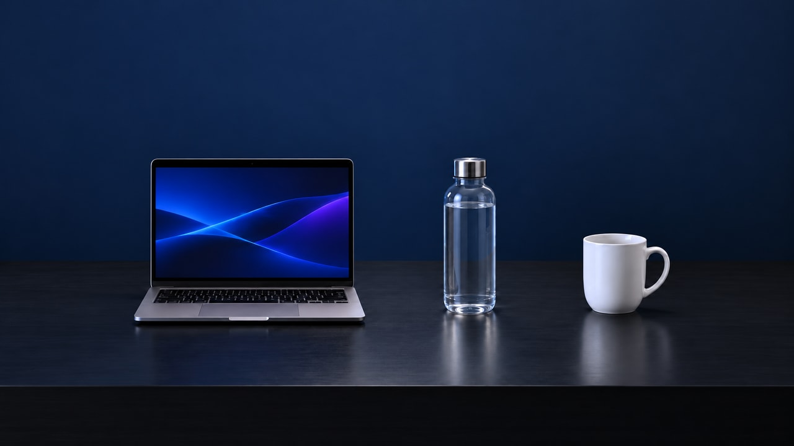
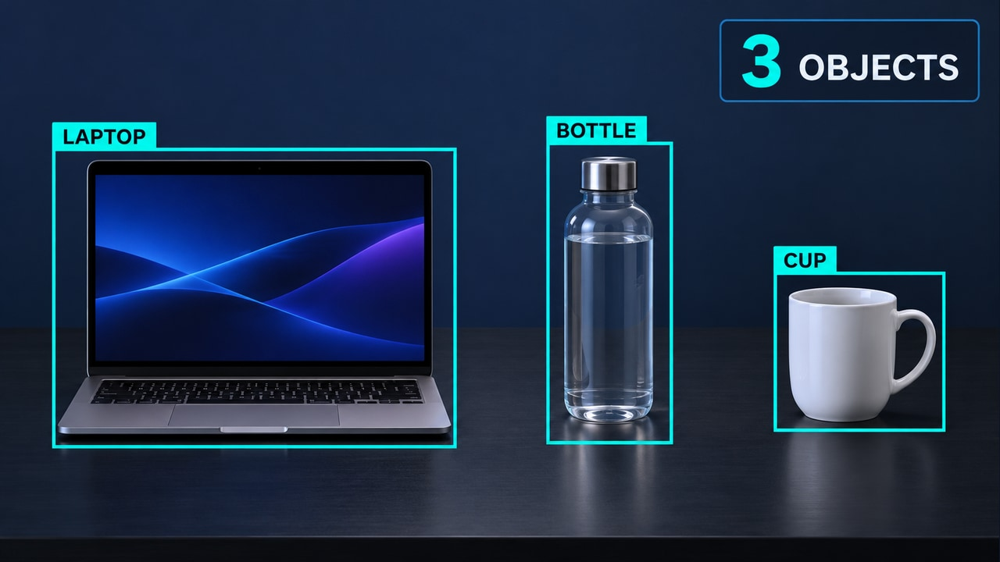

# Conteo e inspección con cámara — pareja v3

**Inicio:** Plano abierto de la misma escena, sin detecciones.

**Final:** Tres objetos identificados y contados.

En Firefly: Frames → First → start.jpg; Last → end.jpg. Usa firefly-prompt.txt completo. 16:9, 720p, 8 segundos, 24 FPS, Audio off.

La transición tiene acciones nuevas y un resultado visible; no debe ser una disolución de toda la imagen ni limitarse a resaltes. Sigue los tiempos y restricciones del prompt. Revisa identidad/geometría, texto, fuentes, valores y sincronización durante todo el video. Los frames orientan los extremos, pero no garantizan una interpolación correcta.

**Estado:** frames preparados; video Firefly pendiente de generación y revisión temporal.

## Revisión vigente 3.5 — movimiento de cámara

START abre el encuadre; END mantiene el plano final con las tres detecciones. La cámara hace un acercamiento continuo con una corrección lateral mínima y paralaje suave, frenando hasta coincidir con END a los seis segundos. Los últimos dos segundos quedan quietos para leer los resultados.

No añadir un zoom extra sobre el plano final. La distancia del recorrido se guía por los dos frames reales, no por un porcentaje supuesto. Los productos permanecen físicamente quietos; las cajas cambian de posición y tamaño en pantalla siguiendo la proyección de cada objeto durante todo el recorrido. Etiquetas ancladas a sus cajas; contador fijo en pantalla. Rechazar cajas que flotan, se atrasan o cortan el producto. El video con movimiento todavía debe generarse y revisarse.
