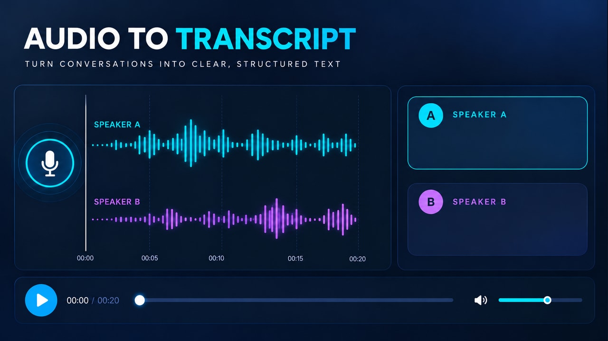
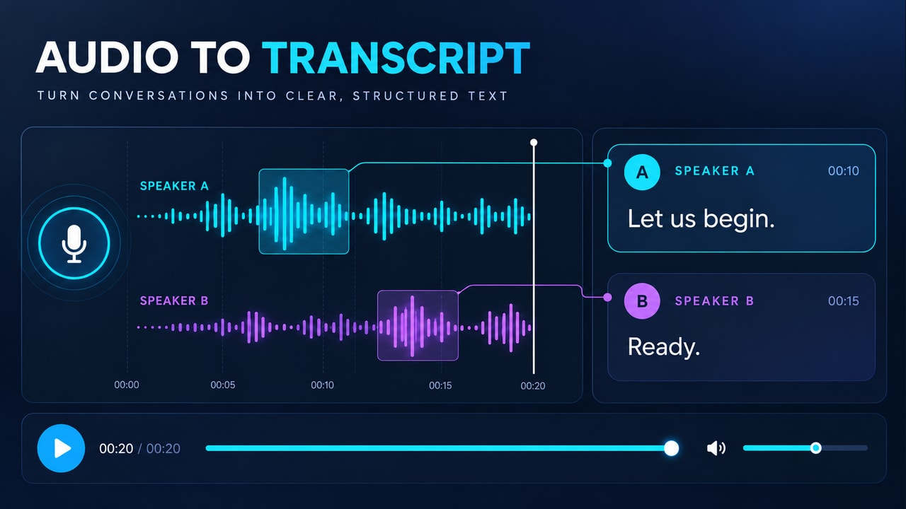

# Actas de reuniones y llamadas automáticas — pareja v3

**Inicio:** Ondas del audio precargado ya visibles; timer 00:00 / 00:20, barra vacía, cursor en el tick inicial y transcripción vacía.

**Final:** 00:20 / 00:20, barra completa, cursor en 20 segundos, ondas procesadas y texto atribuido a cada hablante.

En Firefly: Frames → First → start.jpg; Last → end.jpg. Usa firefly-prompt.txt completo. 16:9, 720p, 8 segundos, 24 FPS, Audio off.

La transición tiene acciones nuevas y un resultado visible; no debe ser una disolución de toda la imagen ni limitarse a resaltes. Sigue los tiempos y restricciones del prompt. Revisa identidad/geometría, texto, fuentes, valores y sincronización durante todo el video. Los frames orientan los extremos, pero no garantizan una interpolación correcta.

**Estado:** frames preparados; video Firefly pendiente de generación y revisión temporal.

## Registro histórico 3.2 — sustituido por 3.4

Se corrigieron ambos frames. El cursor vertical, el timer inferior, la barra y el área procesada de ondas comparten el mismo avance. Las ondas se construyen al paso del cursor y los segmentos terminados se estabilizan. A los seis segundos del clip se llega al final de la muestra; los últimos dos segundos muestran ese estado terminado.

El audio de ejemplo dura 20 segundos, representados de forma acelerada en ocho segundos de video conceptual. No se afirma una velocidad real de procesamiento. Las marcas 00:10 y 00:15 de las frases son tiempos de intervención de cada hablante y permanecen intactas; solo el timer de reproducción termina en 00:20 / 00:20.

Rechazar el video si aparece un cursor extra en 00:10, si la barra queda a mitad, si hay audio visual después de 00:20, si se deforman los dígitos o si ondas/barra/cursor muestran avances diferentes. El video nuevo todavía debe generarse y revisarse.

## Revisión 3.3 — límite de prompt

Prompt condensado a menos de 2.500 caracteres conservando el avance único sincronizado, timer 00:00 → 00:20, marcas de intervención fijas y pausa final. Los frames no cambian.

## Revisión vigente 3.4 — ondas desde el primer frame

Usar el START nuevo con ondas ya visibles, no la versión anterior de líneas planas. END no cambia. El video comienza con actividad local cyan de A antes de 0,25 s; a los 3 s aparece su frase. B se activa solo después y su frase aparece a los 4,5 s. Cursor, timer y barra recorren 00:00 → 00:20 entre 0 y 6 s. Los últimos dos segundos mantienen el final.

Las ondas pertenecen a una grabación precargada; no se construyen desde cero ni aparecen al llegar al final. Solo los pequeños segmentos activos oscilan: el patrón grabado permanece reconocible. La demostración sigue acelerada y silenciosa. Se revisó el nuevo frame; el video corregido todavía no fue generado ni validado temporalmente.
