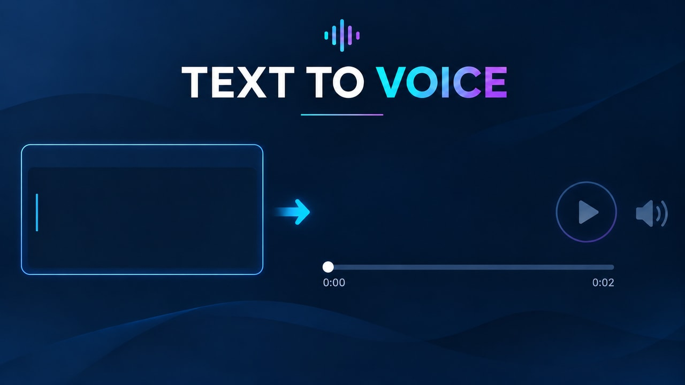

# Dale voz a tu contenido — pareja v3

**Inicio:** Input vacío con cursor visible, sin onda, barra vacía y bolita al inicio.

**Final:** Welcome. escrito, onda generada, barra completa y bolita al final de 0:02.

En Firefly: Frames → First → start.jpg; Last → end.jpg. Usa firefly-prompt.txt completo. 16:9, 720p, 8 segundos, 24 FPS, Audio off.

La transición tiene acciones nuevas y un resultado visible; no debe ser una disolución de toda la imagen ni limitarse a resaltes. Sigue los tiempos y restricciones del prompt. Revisa identidad/geometría, texto, fuentes, valores y sincronización durante todo el video. Los frames orientan los extremos, pero no garantizan una interpolación correcta.

**Estado:** frames preparados; video Firefly pendiente de generación y revisión temporal.

## Registro 3.10 — escribir, generar y reproducir

Usar ambos frames nuevos junto con el nuevo prompt.

- 0–1 s: cursor parpadea en input vacío.
- 1–2,5 s: se escribe exactamente Welcome., carácter por carácter; bolita quieta.
- 2,5–3,5 s: se genera y completa la onda; bolita todavía quieta.
- 3,5–5,5 s: reproducción de la muestra de 2 segundos: onda varía de amplitud y bolita avanza de izquierda a derecha con el relleno.
- 5,5–8 s: pausa del estado completado; bolita en el extremo derecho y barra llena.

0:00 y 0:02 son etiquetas fijas de los extremos del eje, no un timer de tiempo transcurrido. El MP4 conceptual sigue sin audio. No aceptar reproducción antes de terminar el texto/onda ni ondas que aparecen recién al final. Se revisaron ambos frames; escritura, amplitud y sincronización requieren revisión del video generado.

## Revisión vigente 3.11 — inserción real de caracteres

First y Last se conservan. Cada pulsación inserta de golpe un glifo completo y opaco, con ocho estados discretos: W → We → Wel → Welc → Welco → Welcom → Welcome → Welcome. El cursor salta al nuevo final después de cada inserción, sin recorrer las letras. Los caracteres futuros no existen a la derecha del cursor.

Se prohíbe descubrir una palabra ya dibujada mediante wipe, máscara, recorte, fade o barrido de luz. El primer carácter debe ser una W completa, nunca media W o V. Después se mantienen generación de onda y reproducción hasta el final.

El prompt cabe en 2.500 caracteres. Revisar los fotogramas de escritura del video nuevo; esta instrucción no garantiza glifos perfectos del generador.

## Vía recomendada 3.12 — MP4 programado ya disponible

Las nuevas pruebas del usuario siguieron mostrando revelado parcial de letras pese al prompt. Se generó un clip por Canvas/FFmpeg con glifos completos y cursor por saltos, sin capas web. Ver [MP4, pruebas y regeneración](rendered-v1/README.md). Los JPG y el prompt Firefly se conservan, pero no hace falta volver a generar este clip en Firefly para obtener escritura correcta. El MP4 sigue sin integrarse en producción.

## Flujo activo 3.13 — Firefly solicitado por el usuario

Se aplica la descripción simplificada de una interacción real de input: ocho inserciones de caracteres completos, con salto de cursor después de cada pulsación y sin palabra oculta que descubrir. Fases: 0–1 s cursor; 1–3 s escritura; 3–4 s generación; 4–6 s reproducción; 6–8 s final. First/Last no cambian. El MP4 programado permanece como alternativa.

Verificado en la descripción: cada estado añade exactamente un carácter; W inicial completa; glifo pasa de ausente a visible en un fotograma; no wipe/máscara/fade; onda antes de reproducción; bolita termina a la derecha; límite de 2.500 caracteres.

Validación pendiente del nuevo video Firefly: revisar los fotogramas de cada inserción. Aceptar solo si cada primera aparición tiene el glifo completo, sin fases de media letra, y los caracteres anteriores permanecen intactos. No es posible certificar ese resultado solo leyendo el prompt.
