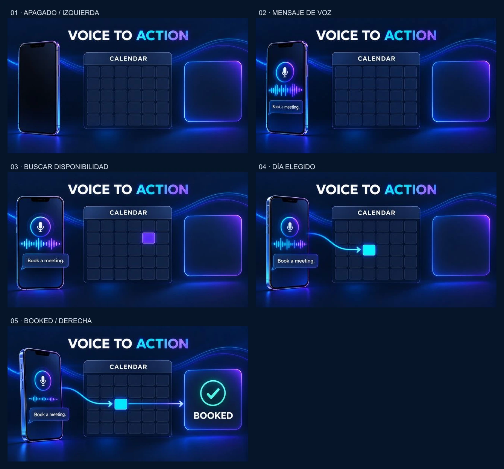

# Recepcionista por voz — storyboard de cinco estados v3.14

# Agente de voz — cinco fotogramas para Edit video

Kit de autoría v1. Imágenes generadas; no incluye un nuevo video Firefly ni se ha activado en producción. La demo conserva su estado Roadmap.

| Fotograma | Momento orientativo | Estado |
|---|---|---|
| 01-off.jpg | 0% (0 s en 8 s) | Móvil apagado, orientado a la izquierda; calendario y confirmación vacíos. |
| 02-message.jpg | 25% (2 s) | Pantalla encendida y mensaje de voz; ondas activas. |
| 03-search.jpg | 55% (4,4 s) | Candidato violeta en fila 2, columna 5 tras recorrer otros días. |
| 04-selected.jpg | 75% (6 s) | Fila 3, columna 3 elegida en cian; todavía sin BOOKED. |
| 05-booked.jpg | 100% (8 s) | Móvil orientado a la derecha; flecha de salida, check y BOOKED. |

## Uso en Adobe Firefly

1. En Video > Prompt to edit clip, carga tu video existente. Copia adaptive-edit-prompt.txt completo; sus fases son porcentajes de la duración T. No pegues simultáneamente los cuatro prompts de transición.
2. Según la documentación consultada, Ray3.14 Modify / Ray3 Modify permiten First frame y Last frame. Si los controles están disponibles, usa 01-off.jpg y 05-booked.jpg. No se ha verificado un control que acepte cinco fotogramas temporales simultáneamente.
3. Los estados 02–04 son referencias intermedias para revisar o trabajar por segmentos. Para controlar cada transición, usa pares consecutivos y su edit-N-to-N+1.txt en el segmento correspondiente, con un modelo que permita esos extremos; ensambla y ajusta duración en el editor. Una imagen de referencia no equivale por sí sola a un keyframe temporal.
4. Mantén 16:9; exportación web prevista 720p, 24 FPS, sin audio. El prompt adapta fases al clip; el modelo puede limitar duración y controles disponibles.

Fuente oficial: https://helpx.adobe.com/firefly/web/work-with-audio-and-video/work-with-video/edit-generated-video-using-text-prompts.html

## Movimiento y control de calidad

El móvil gira suavemente desde izquierda a derecha pasando por frontal; leve dolly y paralaje sin recortar paneles. Los fotogramas muestran poses distintas; la amplitud de las ondas debe variar repetidamente dentro del video, no solo interpolar las dos siluetas. El calendario es una cuadrícula conceptual de seis columnas por cinco filas, preservada del diseño existente; no representa un mes real. Recorrer candidatos (1,2) → (2,3) → (2,5), luego elegir (3,3), y solo después confirmar. Índices desde arriba/izquierda. Los mensajes son ilustrativos; no hay una reserva real.

Rechazar si hay BOOKED/check antes de elegir, más de una celda candidata activa, cambio de celda tras elegir, texto deformado, geometría variable, ondas estáticas o móvil que se dobla. Inspeccionar el MP4 completo: los cinco fotogramas y el prompt no garantizan una interpolación correcta.

Cada prompt está por debajo de 2.500 caracteres, incluido el salto final. Ver manifest.json para medidas, hashes y procedencia.

